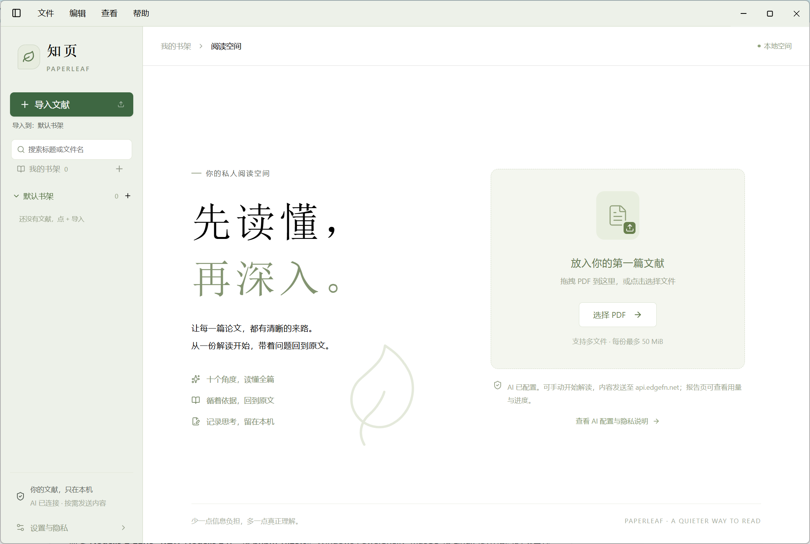
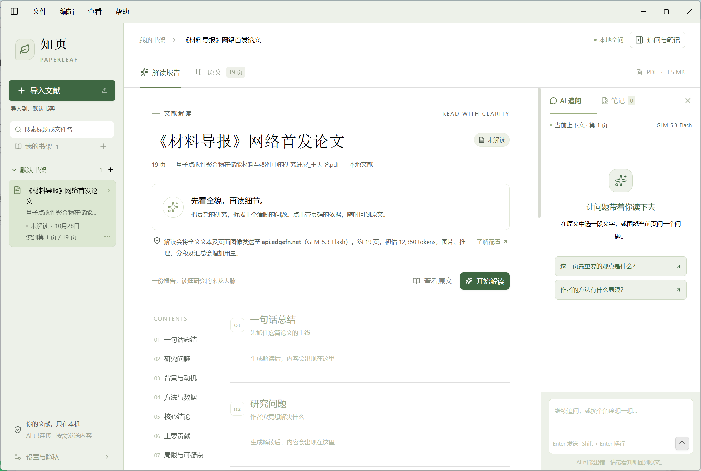

# 知页 Paperleaf

一个本地优先、单用户的极简文献解读器：**上传 PDF → 先看整篇解读 → 回到原文核对 → 划词追问 → 留下笔记**。

中文界面，不需要账号。未配置 AI 时，书架、PDF 阅读、页码记忆和笔记均可独立使用。没有标签系统、BibTeX、云同步或统计追踪。

<p align="center">
  
</p>

## Windows 桌面版（无需命令行）

1. 打开 [下载页面（GitHub Releases）](https://github.com/zh-984/PaperLeaf/releases/latest)，下载 `Paperleaf-Setup-0.7.0-x64.exe`。
2. 在 Windows x64 电脑上双击安装，按提示完成后打开桌面的 **知页 Paperleaf**。
3. 导入 PDF 后可直接阅读和记笔记；需要 AI 解读时，在设置中填写自己的 API 地址、Key 和模型名称。

安装包已内置运行环境，无需安装 Node.js 或手工启动服务。该版本尚未签名，Windows 可能提示无法验证发布者，请确认安装包来自本项目的 GitHub Releases。GitHub 发布页提供 SHA-256 校验文件供核对。

桌面版从左下角 **设置与隐私** 填写 API 地址、API Key 和模型名称，保存立即生效。其余阅读参数已预设。数据保存在 `%APPDATA%\Paperleaf\data`，更新安装不覆盖文献和笔记。完整说明见 [桌面版使用说明](docs/DESKTOP.md)。

## 10 分钟启动

需要 **Node.js ≥ 22.13（推荐 Node.js 24）** 和 **pnpm 11.25.0**。Windows PowerShell、macOS 和 Linux 使用相同的项目命令；本项目已在 Windows 上实际验证。

```powershell
# 如果尚未安装 pnpm，在自己的 Node.js 环境中安装：
npm install -g pnpm@11.25.0

# 在项目根目录执行：
pnpm install
pnpm db:deploy
pnpm dev
```

打开 [http://127.0.0.1:3000](http://127.0.0.1:3000)。安装脚本会创建 `.env`、本地数据目录和 PDF.js 离线资源；不会覆盖已有 `.env`。

首次安装需要网络下载依赖。**安装完成后，核心阅读功能不需要外网。** 服务默认只监听 `127.0.0.1`。此版本没有身份认证，请保持本机使用。

生产方式运行：

```powershell
pnpm build
pnpm start
```

`pnpm dev` 和 `pnpm start` 不要同时占用同一端口。端口被占用时可使用 `pnpm dev --port 3001`。

## 配置 AI

打开左下角 **设置与隐私**，只需填写：

1. API 地址：服务商提供的兼容 API 根地址，例如 `https://example.com/v1`。也能粘贴完整的 `/chat/completions` 地址，程序会规范化。
2. API Key：服务商密钥。保存后不回显；以后留空表示保留原 Key。
3. 模型名称：服务商提供的模型 ID。

点击 **保存 AI 配置** 立即生效，无需编辑文件或重启。点击 **移除 Key** 可关闭 AI。普通模型支持时使用低随机性；GLM 5 系列自动使用较低推理强度并为思考和最终回答预留联合预算。默认 120 秒超时，配合分段缓存、有界上下文、逐板块输出及依据核对。识别为视觉模型（包括 GLM-5.3-Flash）时，整篇解读还会分组读取所有页面图像，追问会附上当前页图像。模型参数不兼容时最多尝试一次兼容调整，不无限重试。

服务须兼容 Chat Completions 并能输出 JSON。首次可用环境变量配置：`OPENAI_BASE_URL`、`OPENAI_API_KEY`、`OPENAI_MODEL`、`AI_ENABLED=true`；在界面保存的配置优先，Web 版存于 `data/ai.env`，桌面版存于 `%APPDATA%/Paperleaf/ai.env`，Key 仅由本机服务端读取。详见 `.env.example`。模型能力仍由所选服务决定，本地预设不能替代高质量模型。

### 隐私与费用

- PDF 文件、文本提取结果、报告、分段缓存、追问历史和笔记均保存在本机。
- **默认导入后不自动调用 AI，点击“开始解读”才发送全文文字，以及支持视觉时的 PDF 页面图像。** 0.5.0 升级也会将自动解读切换为关闭；确实需要时，可在“常规”中重新开启。上传区、页头、报告页和设置弹窗均有提示。
- 划词追问发送当前页上下文、选区、问题和同页最近几轮对话；视觉模型还会收到当前页图像，不发送 PDF 文件本身。
- 报告页初估用量为 `页数 × 650 tokens`，不是精确 tokenizer 结果；分段摘要、页面图像、推理、汇总和 10 个报告板块都会产生额外用量。实际费用、数据留存和训练政策由供应商决定。
- 支持把 Base URL 指向本机兼容服务。程序不预置任何供应商 Key。
- 关闭 AI：在设置中移除 Key；已保存的报告和历史仍可查看。

### 长文与失败续跑

全文先按页提取，再按字符预算分段。每段生成保留页码和短原文依据的摘要，摘要过长时递归合并，最后逐个生成 10 个报告板块。

每次请求的输入有界，不会把任意长度全文一次发送给模型。成功的分段以“输入内容 + 模型 + 服务地址 + 提示词版本”哈希缓存在 SQLite 中；每个完成的板块也立即保存。限流、超时、非法 JSON 等失败会保留进度，点击“继续解读”复用已经完成的工作。

“重新解读”会重生成报告板块，但仍复用同模型、同服务的分段缓存。刷新和重启不会自动重复请求已完成的报告。服务重启中断的任务会显示失败状态，允许手动继续。

**计费边界：**已成功落库的分段不会重复请求。若供应商已经计费、响应却在网络中丢失，兼容 API 没有通用的幂等计费协议，本项目无法承诺这种情况下完全不重复收费。

## 项目书架与设置

文献页顶部和追问空状态背景保持白色，图标、标题、建议问题和输入区域外围跟随主题；“追问与笔记”两种面板共用默认宽度和拖拽宽度。桌面打包剔除非运行的映射与类型文件，PDF 离屏资源及时释放。

Word 引用和文末参考文献联动目前仅规划，路线、数据模型与验收范围见 [Word 联动方案](docs/WORD-INTEGRATION-PLAN.md)，本版不包含 Word 插件。

- 左侧“我的书架”旁点 **+** 可新建并命名项目书架。每个书架可独立折叠，状态保存到 SQLite。顶部导入按钮会显示当前导入目标，也可点书架行的 + 定向导入。
- 每篇文献属于一个书架，文献“…”中可移动；删除书架只把文献移回默认书架，PDF、笔记、报告不删除。原有文献升级后留在默认书架。
- Ctrl+F 可聚焦书架搜索，按标题、文件名或书架名称查找；搜索时临时展开匹配分组，清空后恢复折叠状态。
- 左下角“设置与隐私”改为左右分栏：常规、文件与存储、AI 配置、阅读与外观、隐私与提示、快捷键与关于。支持设置默认阅读视图、自动解读、适应宽度和减少动画。
- “阅读与外观”可选择浅绿、浅蓝、浅黄、纯白四种主题；只改变外围侧栏和工具栏，解读、原文与笔记内容保持纯白，正文纯黑且不透明。主题立即保存，重启后保留。
- 文献和书架的“…”菜单点击外部或按 Esc 收起。阅读只在内部滚动，侧栏底部固定贴合窗口。
- 顶部 AI 提示条右侧的 × 只隐藏提示，不关闭 AI；隐藏状态持久保存，可在“隐私与提示”中恢复。
- Windows 桌面使用集成标题栏，文件、编辑、查看、帮助在顶部；系统窗口按钮仍保留。

## 怎么使用

<p align="center">
  
</p>

没有现成 PDF 时，可使用 [examples/sample-paper.pdf](examples/sample-paper.pdf)。它是明确标注的三页合成演示文档，不是真实论文。

1. 点击“导入文献”或将 PDF 拖入页面；支持多文件逐个导入。默认每份 50 MiB、一次 10 份。
2. 上传后默认打开“解读报告”，点击“开始解读”才请求 AI；按板块显示进度，不必等全篇完成。
3. 报告包含一句话总结、研究问题、背景与动机、方法与数据、核心结论、主要贡献、局限与可疑点、术语表、阅读路线、可能的追问。
4. 点击“查看原文依据”跳到对应页并高亮。引句没有匹配到 PDF 文本时会注明“依据未核实”，仅跳页供人工核对。
5. 切换“原文”，连续滚动浏览全部页面，也可通过页码、上一页/下一页快速定位，支持缩放与适应宽度。页码和页内滚动位置自动保存。远处页面只保留占位，避免长文同时占用大量画布内存。
6. 鼠标划选文本，可直接“记笔记”，或选择翻译、通俗解释、术语解释或追问。右侧面板保留对话，可继续提问、复制、保存回答。也可以问与文献无关的问题：AI 会区分原文依据和一般知识，不能确定时应说明。
7. 笔记内部保存原句、页码及归一化选区坐标，右侧只显示笔记正文；页边与笔记使用相同的（1）（2）编号，按页码和原文纵向位置自动排序。点击编号打开对应笔记，笔记页码按钮回跳原文。窄栏两种面板共用默认 320px，可拖动左边缘拉宽；输入框随换行自动增高。侧栏默认按本页筛选，也可切到全部。旧版笔记仍能按页码和引句回跳。“笔记”里可手动新建或编辑；停止输入约 650ms 自动保存，也会在失焦时保存。浏览器本机保留未保存草稿，联网恢复或重新打开笔记时可恢复。不要在保存中清除浏览器数据。
8. 书架文献右下角“…”可重命名和删除。删除会同时清理 PDF 及关联报告、缓存、历史、笔记。

## 数据与备份

```text
data/
  library.db       SQLite 数据库
  uploads/         随机 UUID 文件名的 PDF
  tmp/             正在上传的临时文件
public/pdfjs/      安装时复制的 worker / 字体 / CMap / WASM
```

关闭服务后备份整个 `data/` 目录即可。还应保存自己的 `.env`（其中包含密钥，妥善保管）。删除 `node_modules/` 或 `.next/` 不影响数据。`data/`、`.env`、PDF.js 生成资源和测试产物均被 Git 忽略。

`DATABASE_URL` 的相对路径以 `prisma/schema.prisma` 所在目录为基准；例如 `file:../data/library.db`。`DATA_DIR` 相对项目根目录，决定 PDF 和临时文件位置。如需迁移目录，应同时检查这两个变量并搬迁现有数据，不能只修改路径。

文件系统和 SQLite 不能共享事务。上传失败会补偿清理临时文件；删除文献时在数据库事务内写入文件清理任务，文件被占用时明确提示，并在下次加载书架时重试。

## 环境变量

全部配置列在 `.env.example`。常用项：

| 变量                      | 默认值                      | 用途                                     |
| ------------------------- | --------------------------- | ---------------------------------------- |
| `DATABASE_URL`            | `file:../data/library.db`   | SQLite 路径                              |
| `DATA_DIR`                | `./data`                    | 上传与临时文件目录                       |
| `MAX_UPLOAD_MB`           | `50`                        | 单文件 MiB 限制，最高 500                |
| `MAX_UPLOAD_FILES`        | `10`                        | 界面单次选择上限                         |
| `AI_ENABLED`              | `false`                     | AI 总开关                                |
| `OPENAI_BASE_URL`         | `https://api.openai.com/v1` | 兼容 API 根地址                          |
| `OPENAI_API_KEY`          | 空                          | 仅服务端读取                             |
| `OPENAI_MODEL`            | `gpt-4o-mini`               | 模型标识，按供应商调整                   |
| `AI_TIMEOUT_MS`           | `60000`                     | 单次模型请求超时                         |
| `AI_CHUNK_CHARS`          | `10000`                     | 单段字符预算                             |
| `AI_MAX_INPUT_CHARS`      | `14000`                     | 生成资料预算，需给系统提示和输出预留空间 |
| `AI_MAX_OUTPUT_TOKENS`    | `2000`                      | 单板块最大输出 tokens                    |
| `NEXT_TELEMETRY_DISABLED` | `1`                         | 禁用 Next.js 框架遥测                    |

## 工程结构与技术取舍

```text
src/app/                    页面、样式、API 路由
src/components/             书架、报告、PDF 阅读器、追问、自动保存笔记
src/lib/                    共享类型、Zod 校验、分段、依据校验、Range 解析
src/server/                 Prisma、本地存储、PDF 提取、报告与追问服务
prisma/schema.prisma        Paper / InsightReport / ChunkCache / Note / AiHistory
prisma/migrations/          可重复部署的数据库迁移
scripts/setup.mjs           本地目录、SQLite 空文件、PDF.js 资源准备
tests/                      单元、组件、真实 SQLite API 测试与浏览器测试
docs/                       验收记录与演示说明
```

Next.js 16 App Router + React + TypeScript strict + Tailwind CSS。按需使用 shadcn 风格的 Radix 按钮和对话框；没有全局状态库。PDF.js 固定为开发时 registry 最新的 `6.4.299`，worker 与主库同版并本地托管。Prisma 固定 `6.19.3`，保留稳定的 SQLite 原生引擎和迁移流程，避免引入额外 SQLite 驱动适配层；这不影响使用 SQLite + Prisma 的要求。

只创建 canvas 和文本层，不创建 PDF scripting manager 或交互表单脚本层，XFA 关闭。PDF 文本与 AI 回答通过 React 纯文本渲染，不注入 HTML。所有写入接口使用输入校验和基础同源检查，上传校验扩展名、MIME、大小和 `%PDF-` 文件头，再实际解析；磁盘文件名由服务端生成。文件通过受控接口和 HTTP Range 读取，不暴露真实磁盘路径。

## 测试

```powershell
pnpm typecheck
pnpm lint
pnpm test
pnpm build
pnpm format:check

# 首次安装浏览器后运行完整流程
pnpm exec playwright install chromium
pnpm test:e2e

# 先完成 build 和 e2e，再验证完整生产进程重启后的持久化
pnpm test:restart
```

Vitest 使用 `.test-data/unit/` 独立 SQLite。Playwright 自动启动 3100、3101 两个独立服务，以及 4123 本地模拟 AI；使用 `.test-data/e2e-local/`、`.test-data/e2e-ai/`，不读写正常 `data/`。

模拟接口只存在于测试文件，不会被产品路由导入或作为真实 AI 降级。它验证报告格式、分板块展示、依据跳转、追问、笔记和长文重试，**不证明真实模型的解读质量或供应商兼容性**。没有真实 Key 时，真实 AI 联调应标为未测试。

浏览器测试完成后可打开 `playwright-report/index.html`；失败时保存 screenshot 与 trace。测试中会生成英文多页 PDF，不依赖第三方论文或外部网络。

## 已知边界

- 扫描件可阅读，但没有文本层时无法解读或划词；暂不含 OCR。
- 加密 PDF 需先在本机解密；损坏 PDF 会提示错误。
- 多栏排版和连字符可能导致引句定位失败；会显示未核实提示，不伪造高亮。
- AI 仍可能误读或产生幻觉，证据匹配只验证引句存在，不证明推论正确。
- 本地单进程 MVP，不支持多实例部署或无持久磁盘的 serverless 环境。
- 数据保存在本机，不代表磁盘加密；需要加密时使用操作系统的磁盘加密与备份工具。

## 排障

- 首次启动提示表不存在：运行 `pnpm db:deploy`。
- Prisma 在 Windows 上首次建库失败：运行 `node scripts/setup.mjs`，再运行 `pnpm db:deploy`。准备脚本会先创建 SQLite 文件。
- Windows 安装或生成 Prisma Client 出现 DLL rename / EPERM：先停止正在运行的本项目 dev/start 和测试服务，再执行 `pnpm install` 与 `pnpm exec prisma generate`。运行中的进程可能占用 SQLite 引擎 DLL。
- PDF worker 加载失败：运行 `node scripts/setup.mjs` 并刷新；不要混用不同版本的 worker。
- AI 显示未配置：确认 `.env` 的开关和 Key，再重启进程；无需重新上传已有文献。
- 报告失败：查看界面错误，修复模型配置或限流问题后点“继续解读”；已完成内容保留。
- 本机代理影响测试：浏览器测试配置只对测试进程清除代理环境变量，不改系统代理设置。

源码及第三方依赖的许可信息见项目 [MIT 许可证](LICENSE) 和各依赖的许可文件。
