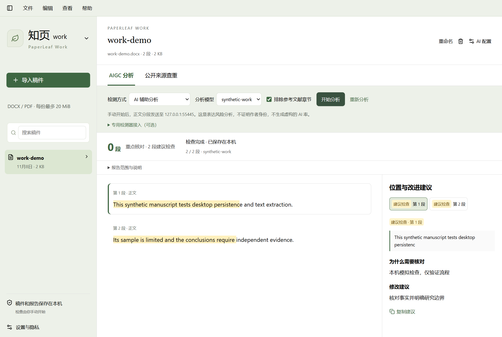

# PaperLeaf Work

Work 是知页中的稿件检查工作区，Read 继续负责文献阅读与引用。点左上角品牌旁的三角切换，模式和上次稿件保存在本机 SQLite，桌面重启后仍可恢复。不需要额外账号或业务订阅，未内置任何付费检测服务或本地大模型权重。

<p align="center">
  
</p>

截图使用合成稿件和本机模拟接口，只展示实际桌面界面与工程流程，不表示真实 AIGC 检测效果。

## 三分钟使用

1. 切换 **PaperLeaf Work**，点“导入稿件”或把 DOCX / PDF 拖入窗口。支持多文件依次导入，每份最多 20 MiB、25 万字符、1000 个文本段。旧版 DOC 请先在 Word 中另存为 DOCX；扫描 PDF 需要先 OCR。
2. 在 **设置与隐私 → AI 配置** 填写兼容 API 地址、Key、模型名称；原有 Read 配置直接复用。可以在 Work 选择三组配置中的任一模型。
3. 选 **AIGC 分析 → AI 辅助分析 → 开始分析**。正文每三段一批发送给选中的服务，每批结束立即保存并更新页面；刷新或重新打开可以继续。API 可能收费，但知页不收检测订阅费。
4. 点击右侧“重点核对 / 建议检查”条目，左侧定位并高亮对应原句。查看理由、修改建议及可选参考表达，点“复制建议”，回到 Word 自己修改。低风险不代表确定为人类写作。
5. 切到 **公开来源查重**，输入主题或关键句，勾选“检索开放论文”并开始查重。也可展开“来源管理”，补充公开文章 / PDF 链接。只有实际读取的正文参与比对。点击匹配条目查看原句、来源片段与链接。
6. 报告保存在本机，可切换历史记录；取消或失败后点“继续检查”复用已成功缓存的分析。“重新分析”明确绕过缓存，可能再次产生 API 费用。修改 Word 原稿后请重新导入新文件，内容不同会产生新的稿件记录。

## 检测结果是什么意思

普通 Chat Completions 模型用于识别模板化、空泛、重复和论证不足等**表达风险**，给出保留事实与引用的修改建议。它不是专门训练、校准过的 AIGC 分类器，不能据此推出“全文多少百分比由 AI 撰写”，本工具不会伪造该比例。

可选的 **专用检测器** 显示真实接口返回的段落评分。该分数不是某个商业查重系统的分数，也不是逐字作者身份概率；不同模型、语种、学科、段落长度和修改方式都会影响误报。实际准确率需要在代表性、带来源标签的中文 / 英文数据集上评测，本版本未宣称达到某个准确率。

公开来源重复率 = 纳入正文中被连续文字匹配覆盖的字符数 / 纳入正文字符数；忽略大小写与标点，使用 NFKC 规范化，至少连续 24 个字母 / 数字字符，重叠片段只计一次。默认排除被识别为参考文献章节的段落，也可取消排除。**这是本次取得来源的文字重复率，不是全网、知网或 Turnitin 查重率**。没有取得来源时显示“未计算”，而不是 0%。同义改写、跨语言复制和图片内文字不在此算法范围内。

自动检索目前覆盖 Europe PMC 开放论文和 arXiv 的可用 HTML 全文，每次最多新增 4 个可读取来源，每份稿件最多保存 12 个来源。中文论文覆盖尤其有限，建议补充公开来源链接。仅发现摘要、网页拒绝访问、全文过大或请求失败时，不把它们冒充已完成全文比对。公开源检索会发送你填写的检索词，未填写时使用稿件标题，不发送整篇私稿；手动 URL 会被访问并缓存正文。

## 可选专用检测器

有兼容检测服务时，在 AIGC 分析下展开“专用检测器接入（可选）”，填写完整接口 URL、模型名和可选 Key 后保存。无需编写知页后端代码。**普通 OpenAI 聊天地址不能直接作为这个分类器接口**；没有兼容服务时，继续使用现有 API 的 AI 辅助表达分析即可。知页没有捆绑或自动搭建专用检测模型。

服务接收 `POST` JSON，最多每批三段，Key 仅在服务端通过 Bearer 请求头发送：

```json
{ "model": "your-detector", "paragraphs": [{ "id": "p1", "text": "待检测的真实段落" }] }
```

必须为每个输入编号返回且仅返回一条分数，0 到 1：

```json
{ "results": [{ "id": "p1", "score": 0.82 }] }
```

界面暂以 ≥0.8 为“重点核对”、≥0.5 为“建议检查”，低于此为低风险；这是显示分档，不能替代模型自己的校准。Key 保存后不回显，清空输入会保留原 Key，“移除保存的 Key”可以清除。也可在服务端环境变量设置 `WORK_DETECTOR_URL`、`WORK_DETECTOR_KEY`、`WORK_DETECTOR_MODEL`。

## 存储、安全和容量

- Work 与 Read 共用一个 SQLite，新增 WorkDocument / WorkTask / WorkSource / WorkCache / WorkPreference 表，数据互相独立。稿件保存在 `DATA_DIR/work/`，数据库保存提取的段落、报告、来源正文、缓存和模式记忆；检测器配置保存在 `DATA_DIR/work-detector.env`。
- 相同字节文件按 SHA-256 去重；删除稿件级联删除报告、来源、缓存并清理原文件。Word 内容只提取文字，不执行宏，不加载外链图片，不解压到任意目录；ZIP 目录及声明解压大小有上限。
- 读取公开来源时校验公网地址、重定向及响应大小，阻止回环 / 内网访问，DNS 固定到已校验 IP。机器配置 HTTP(S) 代理时使用固定 DoH 服务解析公网 IP 并固定 CONNECT 目标；解析域名会发送给 Cloudflare DNS。网络错误会保留已完成内容，任务可以取消，不无限重试。
- 所有 AI 调用由本机服务端发起。默认导入不调用 AI；手动分析才发送段落及相邻少量上下文。请确认稿件可以发送给所选供应商。其他语种、图表、脚注和复杂 DOCX 布局可能提取不完整。
- 依赖使用 Mammoth 提取 DOCX、Cheerio 读取公开网页，复用现有 PDF.js / SQLite / AI 客户端。没有额外的 GB 级模型和公开论文数据库。本机 0.9.0 完整应用安装后约 801 MiB，比原有 0.8.8 增加约 36 MiB；安装包约 242 MiB。用户稿件、来源和报告另外占用空间。

## 开发验证

```powershell
pnpm install
pnpm db:deploy
pnpm dev

pnpm typecheck
pnpm lint
pnpm test
pnpm test:e2e
pnpm desktop:build
pnpm test:desktop
```

Work 测试覆盖实际 DOCX / PDF 解析、去重、写入后重载、段落定位、失败后缓存续跑、公开匹配去重计数、参考文献排除、非法上传与内网来源拦截、检测器配置不泄露 Key，以及删除级联。浏览器和桌面 AI 流程使用隔离数据与本机模拟服务，验证工程流程，**不证明真实模型的检测准确率**。另有 opt-in 的真实公开检索测试，不读取个人稿件。

## 0.9.0 验收记录（2026-11-08，Windows x64）

| 检查                                               | 实际结果                                                                             |
| -------------------------------------------------- | ------------------------------------------------------------------------------------ |
| `pnpm install --frozen-lockfile`、`pnpm db:deploy` | 成功，增量迁移保留现有表                                                             |
| `pnpm dev --port 3309`                             | Ready，验证后停止测试进程                                                            |
| `pnpm typecheck`、`pnpm lint`、`pnpm format:check` | 全部通过                                                                             |
| `pnpm test`                                        | 62 通过，1 项外网测试默认跳过                                                        |
| `pnpm exec playwright test`                        | 完整 17 项通过，包括 Read 回归与 Work 检测器配置                                     |
| `pnpm build`、`pnpm desktop:build`                 | Web 生产构建及 Windows 安装包成功                                                    |
| `pnpm test:desktop`                                | 实际 EXE 的 Read 与 Work 流程通过；DOCX 解析、报告和模式在重启后保留，无重复 AI 请求 |
| `pnpm test:restart`                                | 3 篇隔离测试文献、报告、笔记和追问在生产进程重启后保留                               |
| `WORK_LIVE_NETWORK=1` 的公开来源测试               | 取得实际开放论文全文；单篇远端不可用时有界尝试其他候选                               |

专用检测器测试使用模拟评分，只证明协议接入正确。真实检测器准确率、真实供应商的分析质量未验证；未使用个人稿件或付费 Key 进行这些测试。公开来源并不保证每篇都有可用全文；失败会显示覆盖说明，而不虚构比对成功。

本机已从 0.8.8 安装升级至 0.9.0，实际验证了旧 PDF 阅读、引用入口及 Work 入口。升级生成数据库备份；原有 PDF、报告缓存、笔记、追问历史和 AI 配置均通过升级前后哈希 / 内容核对。
