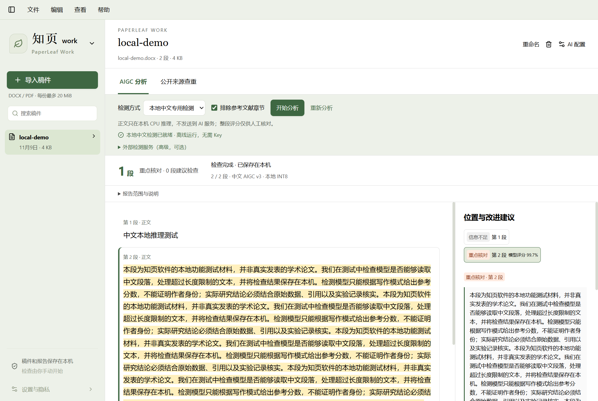

# PaperLeaf Work

Work 是知页中的稿件检查工作区，Read 继续负责文献阅读与引用。点左上角品牌旁的三角切换，模式和上次稿件保存在本机 SQLite，桌面重启后仍可恢复。不需要额外账号或业务订阅。0.9.2 提供一键下载的轻量本地中文检测模型，也保留原有聊天 API 分析与外部检测器接口。

<p align="center">
  
</p>

截图使用合成稿件和本机模拟接口，只展示实际桌面界面与工程流程，不表示真实 AIGC 检测效果。

## 三分钟使用

1. 切换 **PaperLeaf Work**，点“导入稿件”或把 DOCX / PDF 拖入窗口。支持多文件依次导入，每份最多 20 MiB、25 万字符、1000 个文本段。旧版 DOC 请先在 Word 中另存为 DOCX；扫描 PDF 需要先 OCR。
2. 在 **设置与隐私 → AI 配置** 填写兼容 API 地址、Key、模型名称；原有 Read 配置直接复用。可以在 Work 选择三组配置中的任一模型。
3. 选 **AIGC 分析 → AI 辅助分析 → 开始分析**。正文每三段一批发送给选中的服务，每批结束立即保存并更新页面；刷新或重新打开可以继续。API 可能收费，但知页不收检测订阅费。
4. 点击右侧“重点核对 / 建议检查”条目，左侧定位并高亮对应原句。查看理由、修改建议及可选参考表达，点“复制建议”，回到 Word 自己修改。低风险不代表确定为人类写作。
5. 切到 **公开来源查重**，输入主题或关键句，勾选“检索开放论文”并开始查重。也可展开“来源管理”，补充公开文章 / PDF 链接。只有实际读取的正文参与比对。点击匹配条目查看原句、来源片段与链接。
6. 报告保存在本机，可切换历史记录；取消或失败后点“继续检查”复用已成功缓存的分析。“重新分析”明确绕过缓存，可能再次产生 API 费用。修改 Word 原稿后请重新导入新文件，内容不同会产生新的稿件记录。

**无需 Key 的本地方式：** 在“检测方式”选择“本地中文专用检测”，首次点击“下载并启用”（约 99 MiB）。完成后手动点“开始分析”；正文不外发，CPU 运行。模型准备好后重新打开 Work 会优先选择本地检测。AI 辅助分析仍使用已有 API，适合获取上下文理由和改进建议。详见 [模型来源、许可与使用边界](LOCAL-DETECTOR.md)。

## 检测结果是什么意思

普通 Chat Completions 模型用于识别模板化、空泛、重复和论证不足等**表达风险**，给出保留事实与引用的修改建议。它不是专门训练、校准过的 AIGC 分类器，不能据此推出“全文多少百分比由 AI 撰写”，本工具不会伪造该比例。

可选的 **专用检测器** 显示真实接口返回的段落评分。该分数不是某个商业查重系统的分数，也不是逐字作者身份概率；不同模型、语种、学科、段落长度和修改方式都会影响误报。实际准确率需要在代表性、带来源标签的中文 / 英文数据集上评测，本版本未宣称达到某个准确率。

公开来源重复率 = 纳入正文中被连续文字匹配覆盖的字符数 / 纳入正文字符数；忽略大小写与标点，使用 NFKC 规范化，至少连续 24 个字母 / 数字字符，重叠片段只计一次。默认排除被识别为参考文献章节的段落，也可取消排除。**这是本次取得来源的文字重复率，不是全网、知网或 Turnitin 查重率**。没有取得来源时显示“未计算”，而不是 0%。同义改写、跨语言复制和图片内文字不在此算法范围内。

自动检索覆盖 Europe PMC、OpenAlex 开放全文链接和 arXiv；每个源最多尝试两组标题/检索词，支持将“BiVO₄基光阳极化工进展4.1投稿版本”简化为“BiVO4”。arXiv HTML 不可读时回退 PDF；开放文章落地页可跟随声明的 PDF 地址。每次最多新增 4 个正文、最多 12 次候选地址尝试、总读取窗口 110 秒，每份稿件最多保留 12 个正文来源。不下载整库，不保存远端 PDF 或 HTML，只保存提取的文字；单次下载最多 6 MiB、单个正文最多 15 万字符，同一稿件相同 URL/相同正文复用。

“来源检索详情”显示实际检索词、各服务候选数量、取得正文数量和失败原因。没有结果、拒绝访问、限流、超时、没有文本层会分别提示；没有正文仍显示“未计算”，不会冒充 0%。仅发送你填写的检索词或稿件标题及其简化版本，不发送稿件正文；手动 URL 会被访问并缓存正文。中文覆盖仍有限，可补充公开全文链接。OpenAlex 用于发现链接，其元数据不是全文库。

## 可选专用检测器

本地中文检测不需要填写接口。若另外有兼容检测服务，可展开“外部检测服务（高级，可选）”，填写完整接口 URL、模型名和可选 Key 后保存。无需编写知页后端代码。**普通 OpenAI 聊天地址不能直接作为这个分类器接口**。以前显示的“专用检测器未配置”仅指这个外部接口缺少配置，不表示 Read 的聊天模型失效；现在没有外部配置时不再展示无效的检测选项。

服务接收 `POST` JSON，最多每批三段，Key 仅在服务端通过 Bearer 请求头发送：

```json
{ "model": "your-detector", "paragraphs": [{ "id": "p1", "text": "待检测的真实段落" }] }
```

必须为每个输入编号返回且仅返回一条分数，0 到 1：

```json
{ "results": [{ "id": "p1", "score": 0.82 }] }
```

界面暂以 ≥0.8 为“重点核对”、≥0.5 为“建议检查”，低于此为低风险；这是显示分档，不能替代模型自己的校准。Key 保存后不回显，清空输入会保留原 Key，“移除保存的 Key”可以清除。也可在服务端环境变量设置 `WORK_DETECTOR_URL`、`WORK_DETECTOR_KEY`、`WORK_DETECTOR_MODEL`。

## 存储、安全和容量

- Work 与 Read 共用一个 SQLite，新增 WorkDocument / WorkTask / WorkSource / WorkCache / WorkPreference 表，数据互相独立。稿件保存在 `DATA_DIR/work/`，数据库保存提取的段落、报告、来源正文、缓存和模式记忆；检测器配置保存在 `DATA_DIR/work-detector.env`。
- 相同字节文件按 SHA-256 去重；删除稿件级联删除报告、来源、缓存并清理原文件。Word 内容只提取文字，不执行宏，不加载外链图片，不解压到任意目录；ZIP 目录及声明解压大小有上限。
- 读取公开来源时校验公网地址、重定向及响应大小，阻止回环 / 内网访问，DNS 固定到已校验 IP。机器配置 HTTP(S) 代理时使用固定 DoH 服务解析公网 IP 并固定 CONNECT 目标；解析域名会发送给 Cloudflare DNS。网络错误会保留已完成内容，任务可以取消，不无限重试。
- 所有 AI 调用由本机服务端发起。默认导入不调用 AI；手动分析才发送段落及相邻少量上下文。请确认稿件可以发送给所选供应商。其他语种、图表、脚注和复杂 DOCX 布局可能提取不完整。
- 依赖使用 Mammoth 提取 DOCX、Cheerio 读取公开网页，复用现有 PDF.js / SQLite / AI 客户端。没有额外的 GB 级模型和公开论文数据库。本机 0.9.0 完整应用安装后约 801 MiB，比原有 0.8.8 增加约 36 MiB；安装包约 242 MiB。用户稿件、来源和报告另外占用空间。

## 开发验证

```powershell
pnpm install
pnpm db:deploy
pnpm dev

pnpm typecheck
pnpm lint
pnpm test
pnpm test:e2e
pnpm desktop:build
pnpm test:desktop
```

Work 测试覆盖实际 DOCX / PDF 解析、去重、写入后重载、段落定位、失败后缓存续跑、公开匹配去重计数、参考文献排除、非法上传与内网来源拦截、检测器配置不泄露 Key，以及删除级联。浏览器和桌面 AI 流程使用隔离数据与本机模拟服务，验证工程流程，**不证明真实模型的检测准确率**。另有 opt-in 的真实公开检索测试，不读取个人稿件。

## 0.9.0 验收记录（2026-11-08，Windows x64）

| 检查                                               | 实际结果                                                                             |
| -------------------------------------------------- | ------------------------------------------------------------------------------------ |
| `pnpm install --frozen-lockfile`、`pnpm db:deploy` | 成功，增量迁移保留现有表                                                             |
| `pnpm dev --port 3309`                             | Ready，验证后停止测试进程                                                            |
| `pnpm typecheck`、`pnpm lint`、`pnpm format:check` | 全部通过                                                                             |
| `pnpm test`                                        | 62 通过，1 项外网测试默认跳过                                                        |
| `pnpm exec playwright test`                        | 完整 17 项通过，包括 Read 回归与 Work 检测器配置                                     |
| `pnpm build`、`pnpm desktop:build`                 | Web 生产构建及 Windows 安装包成功                                                    |
| `pnpm test:desktop`                                | 实际 EXE 的 Read 与 Work 流程通过；DOCX 解析、报告和模式在重启后保留，无重复 AI 请求 |
| `pnpm test:restart`                                | 3 篇隔离测试文献、报告、笔记和追问在生产进程重启后保留                               |
| `WORK_LIVE_NETWORK=1` 的公开来源测试               | 取得实际开放论文全文；单篇远端不可用时有界尝试其他候选                               |

专用检测器测试使用模拟评分，只证明协议接入正确。真实检测器准确率、真实供应商的分析质量未验证；未使用个人稿件或付费 Key 进行这些测试。公开来源并不保证每篇都有可用全文；失败会显示覆盖说明，而不虚构比对成功。

本机已从 0.8.8 安装升级至 0.9.0，实际验证了旧 PDF 阅读、引用入口及 Work 入口。升级生成数据库备份；原有 PDF、报告缓存、笔记、追问历史和 AI 配置均通过升级前后哈希 / 内容核对。

## 0.9.1 界面调整

Read / Work 共用相同的侧栏宽度、品牌位置、图标尺寸和字体；英文模式名固定在同一行，中文“知页”仅在 Work 模式后加较小的 work。导入按钮、搜索框和设置入口也保持对齐。Work 的导入提示改为紧凑单行，空间留给正文；同时缩小头部和控制区间距，移除搜索框内多余的边框。稿件、检查结果和 AI 配置的存储方式不变。

已实测 980、1440、1920 像素窗口宽度下两种模式的对齐，以及窗口增高后提示条不膨胀。7 项相关浏览器测试、类型检查、Lint、格式检查及实际 Read / Work EXE 冒烟测试通过；测试使用隔离数据和本机模拟 AI。

## 0.9.2 切换与本地检测（2026-11-09）

Read / Work 在新工作区准备完成后再切换；保留已访问页面的搜索和状态，隐藏工作区暂停界面副作用。Work 段落空白收紧，重命名支持 Enter 提交，删除有明确的稿件卡片与取消入口，按钮区统一对齐。

新增中文 AIGC v3 的 INT8 本地分类器，不需要聊天 Key 或独立部署服务。运行时随 Windows x64 安装包提供，模型按需下载并核对固定 SHA-256；CPU 两线程、长段分窗，空闲一分钟释放会话。旧 API 辅助分析和外部检测器仍可用；原有成功缓存保留，避免升级后重复调用付费 API。

本次实际验证：

- 类型检查、Lint、格式检查通过；单元测试 63 通过，2 项外网/模型测试默认跳过。
- 完整浏览器回归 19 项通过，包含延迟加载下切换不闪空白、不闪回主题，搜索保留、段间距和弹窗行为。
- Windows 安装包构建成功；实际 EXE 的 Read / Work 冒烟通过，包括重启持久化。
- 单独启用真实模型测试后，固定文件校验、CPU 推理、长段处理、短段拒判、无 Key 任务和缓存复用通过。
- 实际 EXE 中也完成了合成中文稿件的本地推理，无 AI Key，无第三方稿件发送。该项验证原生模块打包和工程流程，未测定真实检测准确率。

<p align="center">
  
</p>

## 0.9.3 查重验证（2026-11-10）

实际外网测试使用“BiVO₄基光阳极化工进展4.1投稿版本”这个合成标题，自动回退为“BiVO4”；三路服务均返回候选，取得 4 个公开正文，只存约 235 KiB 的提取文字，未保存远端 PDF。随后以已知复制的公开片段运行本地比对，得到 100% 并定位对应片段。这验证来源发现、持久化和逐字匹配流程，不表示对真实稿件具有 100% 查重准确率；未使用私人稿件或付费 AI Key。

单元测试 68 通过（3 项需显式启用的网络/模型用例默认跳过），真实来源用例另行启用并通过；21 项浏览器回归通过，包含 Read/Work 和 new 更新提示条件。测试覆盖 HTML 404 后使用真实 PDF 解析、限流和访问拒绝分类、复用正文、未取得来源不伪造 0%。本机没有 Playwright 自带浏览器时，可运行 `$env:PLAYWRIGHT_CHANNEL='chrome'` 后复用已安装 Chrome 执行浏览器测试，避免另下载浏览器。桌面版更新提示与安装说明见 [桌面说明](DESKTOP.md)。

## 0.9.4 AI 分析续跑与紧凑布局

截图中的“AI 未返回有效分析 JSON”意味着服务已经返回回答，但回答未满足分析数据结构，不是本地中文模型没有安装。此版本对 Work 请求启用 JSON 模式，不支持该参数的服务最多尝试一次兼容调整；报告与普通追问的完整性检查保持原样。

- 本地处理 JSON 外围文字、代码块、尾随逗号和字符串裸换行，不执行模型代码，也不推断缺失的风险等级。
- 外层被截断时保留其中完整、通过校验的段落；本批最多补请求一次，只请求仍缺失的段落。成功内容立即写入细分缓存，网络失败后手动继续也可复用。完整批次归并为原批次缓存并移除临时细分副本；旧版已成功的批次不重新计费调用。
- 补查仍失败的段落显示“待重试”，不作为低风险结果；可以继续检查后文。连续两批完全无效则停止追加请求，避免让整个长文反复消耗 API。认证、网络等错误不自动循环重试。格式补查可能产生供应商 API 用量。
- 手动点“重试未完成段落”或“继续检查”可以续跑；“重新分析”仍会绕过缓存。重新打开已有稿件时恢复它上次使用的 AI 辅助/本地检测方式。
- 上方标题、标签、控制条和进度收紧；“说明与高级设置”默认收起，来源详情与报告说明改为弹窗，不挤占正文。右侧段落导航超过一定高度后独立滚动，建议内容更靠上。查重检索和匹配算法未改动。

`WORK_TEST_MALFORMED=1 node tests/work-desktop-smoke.mjs` 可在隔离的真实 EXE 中模拟截断 JSON、验证只补缺失段落及重启后复用缓存；使用本机模拟服务，不发送个人稿件或调用付费 Key。

本次实际验证：类型、Lint、格式检查通过；72 项单元测试通过（3 项显式启用的网络/模型用例默认跳过）；22 项完整浏览器回归通过。在 1440×800 的 18 段稿件测试中，正文/建议区高度至少 480px，打开详情不改变其位置。实际 Windows EXE 成功恢复截断 JSON，只对缺失的第二段补请求一次，重启后结果保留且未重复调用；Read、Word 引用页面和原有 Work 流程回归通过。这是稳定性验证，不代表 AIGC 准确率评测。

## 0.9.5 历史与检查状态

AIGC 和查重分别显示当前报告的转圈与进度；只有对应标签页显示取消按钮，后台轮询仍会更新正在运行的任务。历史记录标明检测方式、模型、日期和状态，弹出列表最多同时显示六行，超出后内部滚动。点击删除会先确认，删除该次记录及报告，保留原稿、其他报告、来源及可复用缓存；运行中需先取消。设置与隐私新增 Work 检查，并更新数据发送、历史删除和重试说明。

本次类型、Lint 及格式检查通过；既有 72 项单元测试通过，新增历史删除接口用例单独通过；3 项相关浏览器测试通过，包括跨标签页转圈隔离、六行滚动、删除取消/确认、紧凑布局与完整 Work 流程。未使用个人稿件或付费 API 测试。

## 0.9.6 历史卡片与标题

历史收起时只显示检测方式和简短时间，展开宽度缩至 340px；两行分别显示方式/状态和时间/必要的 API 模型，本地模型的重复技术名称不再占位。完整信息可悬停查看，仍最多六行滚动并保留删除确认。

Work 标题使用统一字体并正确渲染已有科学上下标，普通版本号保持正常基线。不修改用户标题数据。标题下只显示 Word/PDF、段数与大小，完整文件名可悬停查看。三个相关浏览器测试通过，覆盖 340px 列表宽度、280px 收起宽度、六行滚动、真正下标与普通版本后缀，以及紧凑阅读区。
